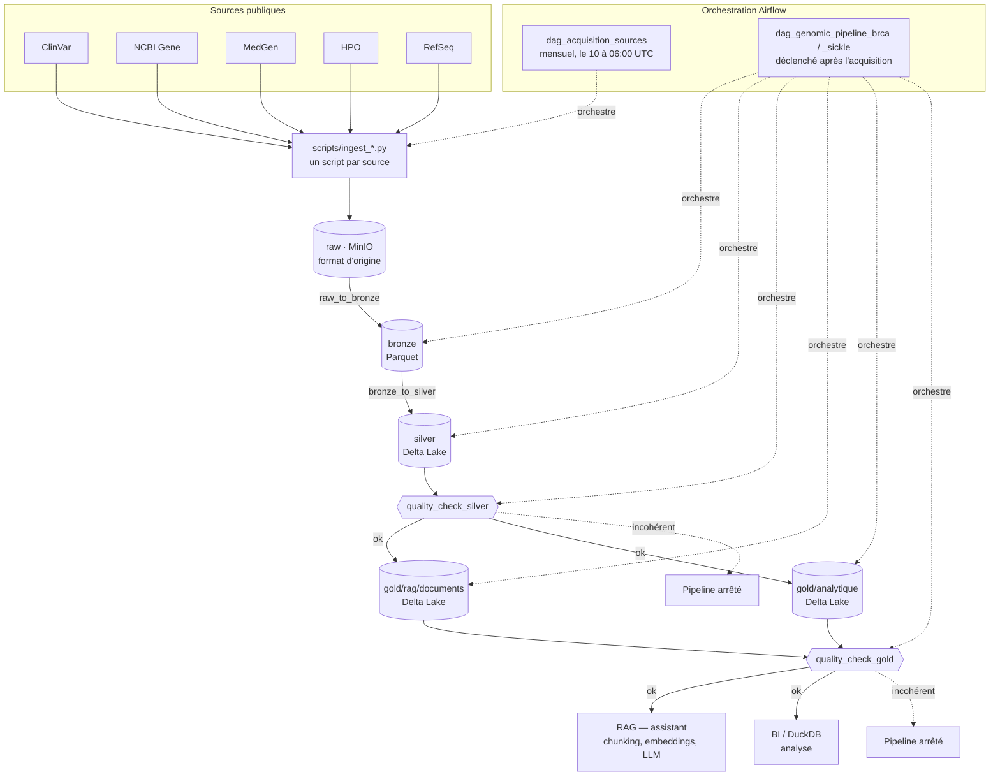

# Système RAG génomique — pipeline de données

## En bref

Ce projet prépare les données d'un **assistant capable de répondre à des questions sur des
variations de l'ADN** (par exemple : « cette mutation du gène BRCA1 est-elle associée à un
risque de cancer ? »). Un tel assistant, de type RAG (*Retrieval-Augmented Generation*), ne
peut répondre correctement que s'il s'appuie sur des données fiables, à jour et bien
organisées. Ce dépôt construit exactement cela :

1. **Collecter** chaque mois les données publiques de référence en génétique médicale (NCBI,
   ClinVar, MedGen, HPO, RefSeq) pour un panel de **18 gènes** : 12 liés au cancer du sein
   héréditaire, 6 liés à la drépanocytose.
2. **Nettoyer et structurer** ces données en plusieurs étapes successives (architecture
   dite « médaillon »), de la donnée brute jusqu'à des tables prêtes à être interrogées.
3. **Orchestrer** l'ensemble automatiquement avec Apache Airflow, et stocker chaque étape
   dans MinIO (un stockage objet compatible Amazon S3).

```
 Sources publiques ──► raw ──► bronze ──► silver ──► gold ──► RAG (assistant)
  (NCBI, ClinVar,     brut    Parquet    Delta,     Delta,
   MedGen, HPO)                          nettoyé    prêt à l'usage
```

| Couche | Rôle | Format | État |
|---|---|---|---|
| `raw` | Copie fidèle de la source, jamais modifiée | format d'origine (TSV, JSONL) | ✅ livré |
| `bronze` | Même contenu, format et noms de colonnes uniformisés | Parquet | ✅ livré |
| `silver` | Données nettoyées, dédoublonnées, reliées entre elles, historisées | Delta Lake | ✅ livré |
| `gold` | Tables finales pour le RAG et pour l'analyse | Delta Lake | ✅ livré |

## Architecture globale du pipeline



- Chaque flèche pleine est un passage de couche (`src/transformations/`) ; chaque flèche en
  pointillés est un déclenchement orchestré par un DAG Airflow (`dags/`).
- Une partition n'est lisible par l'étape suivante qu'une fois son marqueur `_SUCCESS` écrit
  (voir [Principes d'architecture](#principes-darchitecture)).
- Un `quality_check_*` qui échoue arrête le run : la couche suivante n'est jamais écrite à
  partir de données incohérentes.

## Services et ports

Une fois la stack Docker démarrée :

| Service | Adresse | Identifiants | Rôle |
|---|---|---|---|
| **Airflow** (interface web) | http://localhost:8080 | `admin` / mot de passe généré (voir [Connexion à Airflow](#connexion-à-airflow)) | Lancer et suivre les pipelines |
| **MinIO** (console web) | http://localhost:9011 | `MINIO_ROOT_USER` / `MINIO_ROOT_PASSWORD` du `.env` | Parcourir les fichiers de chaque couche |
| **MinIO** (API S3) | http://localhost:9000 | idem | Accès programmatique au stockage |
| PostgreSQL | non exposé (réseau Docker interne) | `POSTGRES_PASSWORD` du `.env` | Base de métadonnées d'Airflow |

Les ports MinIO se changent dans `.env` (`MINIO_API_PORT`, `MINIO_CONSOLE_PORT`) si 9000/9001
sont déjà occupés sur la machine (par Portainer, par exemple).

**Ces trois interfaces ne sont accessibles que depuis la machine elle-même** : elles sont liées
à `127.0.0.1` et non à toutes les interfaces réseau. Ni l'interface Airflow ni la console MinIO
n'ont de TLS ; les exposer au réseau demanderait un reverse proxy devant. Voir
`reference/audit_securite.md`.

Les tâches du pipeline n'utilisent jamais les identifiants root de MinIO : elles passent par un
compte de service (`MINIO_AIRFLOW_USER`), restreint aux quatre buckets par la politique
`airflow-lake` créée au démarrage.

MinIO contient un bucket par couche : `raw`, `bronze`, `silver`, `gold`.

## Démarrage rapide

### Prérequis

- Python 3.12 et Docker (avec Docker Compose v2)
- Une adresse email (exigée par l'API NCBI E-utilities)
- Facultatif : une clé API NCBI, pour 10 requêtes/s au lieu de 3
  (https://account.ncbi.nlm.nih.gov/settings/)

### 1. Installer

```bash
python3 -m venv venv
source venv/bin/activate
pip install -r requirements.txt -r RAG/requirements.txt
pip install pytest==9.1.1 responses==0.26.2 apache-airflow==3.3.1   # tests uniquement
```

### 2. Configurer

```bash
cp .env.example .env
```

Puis renseigner dans `.env` :

| Variable | Valeur |
|---|---|
| `NCBI_EMAIL` | votre adresse email |
| `NCBI_API_KEY` | votre clé NCBI, **ou vide** (une fausse clé provoque des erreurs) |
| `AIRFLOW_UID` | résultat de `id -u` |
| `AIRFLOW_JWT_SECRET` | résultat de `python3 -c "import secrets; print(secrets.token_urlsafe(32))"` |
| `POSTGRES_PASSWORD`, `MINIO_ROOT_USER`, `MINIO_ROOT_PASSWORD` | des valeurs de votre choix |
| `MINIO_AIRFLOW_USER`, `MINIO_AIRFLOW_PASSWORD` | compte de service du pipeline ; mot de passe long, généré comme le secret JWT |

> ⚠️ Les vraies valeurs vont **uniquement** dans `.env` (ignoré par git), jamais dans
> `.env.example`. Restreindre les droits du fichier : `chmod 600 .env`.

### 3. Démarrer la stack

```bash
docker compose --env-file .env up -d --build
```

Le premier démarrage construit l'image Airflow (quelques minutes). Vérifier que tout est sain :

```bash
docker compose ps        # les services doivent être « healthy »
                         # (minio-init et airflow-init s'arrêtent normalement après l'initialisation)
```

Sur une installation neuve, l'index du RAG est vide : `rag-api` est sain mais répond
`503 index_empty` tant que les DAG de panel n'ont pas exécuté `index_rag_documents`
(`RAG/README.md` §4). Aucun redémarrage n'est nécessaire après l'indexation.

Guide de prise en main d'Airflow — lancer un run, lire un échec, relancer une tâche, ajouter
une étape : `reference/guide_airflow.md`.

Protocole d'évaluation du pipeline — les sept niveaux de preuve, l'échantillon de variants à
confronter aux fiches ClinVar, et la grille de résultats à remplir :
`reference/evaluation.md`.

### Connexion à Airflow

Utilisateur `admin` ; le mot de passe est celui que vous avez mis dans `.env` sous
`AIRFLOW_ADMIN_PASSWORD`, réappliqué à chaque démarrage. Pour le relire tel que la stack
l'utilise :

```bash
docker exec genomique-airflow-apiserver \
  cat /opt/airflow/logs/simple_auth_manager_passwords.json.generated
```

## Commandes courantes

### Stack Docker

```bash
docker compose --env-file .env up -d --build   # démarrer (ou reconstruire après modification)
docker compose ps                              # état des services
docker compose logs -f airflow-scheduler       # suivre les journaux d'un service
docker compose down                            # arrêter (les données sont conservées)
docker compose down -v                         # arrêter ET effacer les données (irréversible)
```

### Lancer le pipeline depuis Airflow

Deux familles de DAGs (pipelines Airflow) :

| DAG | Rôle | Déclenchement |
|---|---|---|
| `dag_acquisition_sources` | Télécharge ClinVar et HPO (communs aux deux panels), `raw` → `bronze` | Automatique le 10 de chaque mois à 06:00 UTC, ou manuel |
| `dag_genomic_pipeline_brca` | Panel cancer du sein : sources NCBI, puis `raw` → `bronze` → `silver` → `gold` | Automatique à la fin de l'acquisition, ou manuel |
| `dag_genomic_pipeline_sickle` | Panel drépanocytose : idem | idem |

Dans l'interface, activer les DAGs (interrupteur « unpause »). **Activer suffit pour le mois en
cours** : Airflow lance aussitôt la dernière échéance passée du 10, et la relance de lui-même au
redémarrage si la machine était éteinte ce jour-là (un e-mail « Rattrapage » le signale). Le
bouton ▶ **Trigger** sert à acquérir un autre mois. Un mois déjà publié est sauté
(`skip_if_already_published`), pour ne pas faire tourner les panels deux fois ; le forcer après une
correction demande `force`. En ligne de commande :

```bash
# Acquisition : la date logique (AAAA-MM-JJ) est obligatoire pour un run manuel
docker compose exec airflow-scheduler \
  airflow dags trigger dag_acquisition_sources --logical-date 2026-09-01

# Réacquérir un mois déjà publié (après une correction), ce qui relance aussi les panels
docker compose exec airflow-scheduler \
  airflow dags trigger dag_acquisition_sources --logical-date 2026-09-01 --conf '{"force": true}'

# Un panel, sur des sources déjà acquises à cette date
docker compose exec airflow-scheduler \
  airflow dags trigger dag_genomic_pipeline_brca --conf '{"sources_date": "2026-09-01"}'
```

> Un run de panel va jusqu'au bout : `quality_check_gold` est la dernière tâche, et elle bloque
> la suite si le Gold ne reflète pas fidèlement le Silver.

### Lancer un connecteur à la main (sans Docker)

Chaque source a son script, qui écrit dans la couche `raw`. Sans variable `LAKE_URI`, le lac
est local, dans `data/lake/`.

```bash
source venv/bin/activate
export PYTHONPATH=src:.
D=2026-09-01
G=BRCA1,BRCA2,TP53,PALB2,PTEN,CDH1,STK11,ATM,CHEK2,BARD1,RAD51C,RAD51D

# Sources communes (à lancer en premier : MedGen lit la partition ClinVar)
python -m scripts.ingest_clinvar   --logical-date $D
python -m scripts.ingest_hpo_files --logical-date $D

# Sources par panel (panel sickle : --panel sickle --genes HBB,BCL11A,HBS1L,MYB,KLF1,G6PD)
python -m scripts.ingest_ncbi_gene --logical-date $D --panel brca --genes $G
python -m scripts.ingest_refseq    --logical-date $D --panel brca --genes $G
python -m scripts.ingest_hpo_terms --logical-date $D --panel brca --genes $G
python -m scripts.ingest_medgen    --logical-date $D --panel brca --genes $G
```

### Tests

```bash
pytest -q                  # logique métier : rapide, sans réseau ni conteneur
pytest tests_airflow -q    # structure des DAGs Airflow (passe séparée, plus lente)
```

### Sauvegarder le lac

Les archives mensuelles ClinVar antérieures à 2023 ne sont plus téléchargeables : une perte du
lac ne se rattrape donc pas par un simple rejeu. Le script sauvegarde les quatre buckets, la base
de métadonnées d'Airflow et la **base vectorielle du RAG** (`rag-postgres` : documents, vecteurs,
index, droits), en conservant les quatre dernières copies. La base vectorielle se reconstruirait
depuis le Gold, mais en ~4 h sur CPU ; sa copie se restaure en ~80 s.

```bash
./scripts/sauvegarde.sh                                  # vers ~/sauvegardes-genomique/
DESTINATION_SAUVEGARDE=/mnt/disque-externe ./scripts/sauvegarde.sh
```

- Les dumps PostgreSQL sont faits dans les conteneurs par le socket local (aucun mot de passe ne
  circule) et **relus** (`pg_restore --list`) aussitôt écrits : un dump illisible fait échouer le
  script.
- Les copies ne sont lisibles que par l'utilisateur (`umask 077`) et lui appartiennent (le
  conteneur `mc` tourne sous son identité, sans quoi la rotation ne pourrait plus les supprimer).

**Vérifier qu'une sauvegarde se restaure** (conteneur jetable sans réseau, même image pgvector,
procédure de production rejouée, puis comparaison avec la base en service : documents, modèle
d'embedding, empreintes des identifiants et des vecteurs, index, droits, plus proches voisins) :

```bash
./scripts/verifier_restauration_rag.sh                   # dernière sauvegarde
./scripts/verifier_restauration_rag.sh ~/sauvegardes-genomique/<date>/rag.dump
```

Vérifié le 14/10/2026 : 97 211 documents restaurés en 78 s, six comparaisons sur six identiques ;
un dump tronqué est refusé.

**Vérifier que la base Airflow et le lac se restaurent** (PostgreSQL jetable sans réseau ; MinIO
jetable sur un réseau interne sans sortie) : la base restaurée doit redonner la version du schéma
et l'historique des runs et des tâches terminés avant le dump (comparé à la base en service) ; les
quatre buckets font l'aller-retour sauvegarde → MinIO → disque et doivent revenir identiques octet
pour octet ; chaque table Delta Silver et Gold est relue depuis le MinIO restauré :

```bash
./scripts/verifier_restauration_lac_airflow.sh                 # dernière sauvegarde
./scripts/verifier_restauration_lac_airflow.sh ~/sauvegardes-genomique/<date>
```

Vérifié le 16/10/2026 sur la sauvegarde du 14/10 : 9 runs et 106 tâches, 424 objets (1,9 Go),
24 tables Delta, conforme en 77 s ; un fichier Parquet tronqué dans une copie est signalé
(« illisible ») et fait échouer le script. Relancer un run complet sur une pile restaurée reste à
faire (E3b).

**Restaurer la base vectorielle en production** (après une perte du volume `rag-postgres-data`) :

```bash
docker compose --env-file .env stop rag-api                        # plus aucune lecture
docker compose --env-file .env up -d --wait rag-postgres           # base
docker compose --env-file .env run --rm rag-postgres-init          # schéma et comptes, attend la fin
docker exec -i genomique-rag-postgres pg_restore -U rag_owner -d rag \
  --clean --if-exists --exit-on-error < ~/sauvegardes-genomique/<date>/rag.dump
docker compose --env-file .env up -d rag-gateway                   # relance rag-api
```

Les mots de passe des comptes ne sont pas dans le dump : `rag-postgres-init` les pose depuis `.env`.
`run` et non `up -d` : `up -d` rend la main avant la fin du schéma, et le `pg_restore` qui suit
pourrait partir trop tôt. Pour tout restaurer d'un coup (Airflow, lac, RAG) : `scripts/restaurer.sh`.
Si le Gold a changé depuis la sauvegarde, la prochaine indexation du DAG rattrape l'écart.

**Planification** : `scripts/sauvegarde_si_necessaire.sh` tourne chaque heure et ne lance
`sauvegarde.sh` que si la dernière copie a plus de 7 jours ou précède un run de panel réussi. Une
machine éteinte à l'heure prévue est donc rattrapée à l'heure suivante, et chaque mois acquis est
copié dès la fin de ses runs. Le script ne fait rien si la pile est arrêtée, et reporte la copie si
un run Airflow est en cours, pour ne pas mélanger deux états du lac. À installer avec `crontab -e` :

```
0 * * * * cd /chemin/vers/Projet-_de_Memoire && ./scripts/sauvegarde_si_necessaire.sh >> "$HOME/sauvegarde.log" 2>&1
```

> **Vécu le 23/10/2026 :** la crontab hebdomadaire du 14/10 et ses copies avaient disparu avec
> l'environnement WSL, sans aucune alerte. Après une réinstallation de WSL, vérifier `crontab -l`
> et `ls ~/sauvegardes-genomique`. Une copie sur le même disque ne protège pas d'une panne de ce
> disque : `DESTINATION_SAUVEGARDE` peut viser un disque externe.

**Reprendre après un incident** (mois manqué, e-mail d'échec, table corrompue, lac perdu) :
`reference/procedure_reprise.md`, organisée par symptôme.

### Recevoir les alertes

Le pipeline tourne une fois par mois sans surveillance : sans alerte, un échec ne se voit qu'en
ouvrant l'interface. Airflow envoie un e-mail à chaque échec définitif de tâche (pas aux relances)
par le relais SMTP de [Resend](https://resend.com), port 465 en SSL. Renseigner dans `.env` :

- `RESEND_API_KEY` : clé à permission « Sending access », limitée au domaine d'envoi ;
- `ALERT_FROM` : expéditeur sur ce domaine, vérifié chez Resend (SPF et DKIM) ;
- `ALERT_EMAIL` : destinataires séparés par des virgules.

La connection `smtp_default` est déclarée dans `docker-compose.yml` (`AIRFLOW_CONN_SMTP_DEFAULT`),
jamais dans la base d'Airflow. Laisser `ALERT_EMAIL` vide ne casse rien : seul l'envoi est
désactivé. Après tout changement, vérifier de bout en bout avec le DAG manuel `dag_test_alerte`,
qui échoue exprès :

```
docker compose exec airflow-scheduler airflow dags unpause dag_test_alerte
docker compose exec airflow-scheduler airflow dags trigger dag_test_alerte
docker compose exec airflow-scheduler airflow dags pause dag_test_alerte
```

Un envoi raté n'échoue pas la tâche une seconde fois : il est seulement écrit dans son journal
(`Failed to send notification`). Une alerte qui n'arrive pas se diagnostique donc là.

## Sources de données

| Source | Contenu | Accès |
|---|---|---|
| **ClinVar** | Variants génétiques et leur signification clinique | Fichier mensuel FTP (`variant_summary.txt.gz`, ~440 Mo) |
| **NCBI Gene** | Description et localisation de chaque gène | API E-utilities |
| **MedGen** | Maladies associées, numéros OMIM, modes de transmission | API E-utilities |
| **HPO** | Signes cliniques (phénotypes) associés à chaque gène | Fichier `genes_to_phenotype.txt` + API `ontology.jax.org` |
| **RefSeq** | Transcrits de référence, pour normaliser la notation des variants (HGVS) | API E-utilities (`nuccore`) |

Panels de gènes (`src/ingestion/config.py`) :

- **Cancer du sein héréditaire (`brca`)** : BRCA1, BRCA2, TP53, PALB2, PTEN, CDH1, STK11,
  ATM, CHEK2, BARD1, RAD51C, RAD51D
- **Drépanocytose et modificateurs (`sickle`)** : HBB, BCL11A, HBS1L, MYB, KLF1, G6PD

## Tables de la couche Silver

| Table | Contenu |
|---|---|
| `clinvar_variant` | Un variant par ligne, avec historique des reclassifications (SCD2 : `valid_from`, `valid_to`, `is_current`) |
| `clinvar_variant_gene` | Lien variant ↔ gène (un variant peut toucher plusieurs gènes) |
| `ncbi_gene` | Fiche de chaque gène |
| `refseq_transcript` | Transcrits de référence par gène |
| `medgen_concept`, `medgen_mim`, `medgen_inheritance` | Maladies, numéros OMIM, modes de transmission |
| `hpo_gene_phenotype`, `hpo_term` | Phénotypes par gène et définition de chaque terme HPO |

Chaque table est partitionnée par panel. `quality_check_silver` bloque la suite du pipeline
si une table est absente ou vide, ou si les liens entre tables sont incohérents.

## Tables de la couche Gold

**`gold/rag/documents`** — un document en anglais par variant courant, plus un par gène du
panel, prêt à être vectorisé (mesuré sur l'archive de septembre 2026 : 96 910 documents) :

| Colonne | Contenu |
|---|---|
| `doc_id` | `clinvar:<alleleid>` ou `gene:<SYMBOL>` — identifiant stable |
| `chunk_id` | SHA-256 du texte : il ne change que si le contenu change |
| `doc_type` | `variant` ou `gene` |
| `text` | Le texte vectorisé, listes de maladies et de phénotypes plafonnées |
| `gene_symbol`, `clinical_significance`, `review_status`, `rs_dbsnp`, `hgvs_c`, `hgvs_p` | Métadonnées filtrables |
| `clinvar_variation_id`, `clinvar_url`, `source_version`, `collected_at` | Citation de la source |

Écrit par `MERGE` sur `doc_id`, limité au panel : un document inchangé n'est pas réécrit, un
document dont le variant a disparu est supprimé. L'étape RAG n'aura donc à ré-embedder que les
`chunk_id` qui ont bougé.

**`gold/analytique`** — modèle en étoile, interrogé par DuckDB directement sur les tables Delta :

| Table | Contenu |
|---|---|
| `fact_variant` | Un variant courant par ligne |
| `fact_variant_disease` | Lien variant ↔ maladie |
| `fact_reclassification` | Une ligne par changement de signification clinique |
| `dim_gene`, `dim_disease`, `dim_phenotype`, `bridge_gene_phenotype` | Gènes, maladies, phénotypes |
| `dim_clinical_significance`, `dim_review_status`, `dim_month` | Signification, statut de revue (0 à 4 étoiles ClinVar), temps |
| `agg_variants_by_gene_significance`, `agg_review_status`, `agg_reclassifications_by_month` | Agrégats pré-calculés |

Chaque table est un instantané du panel : un run `brca` ne touche jamais les lignes `sickle`.
`quality_check_gold` bloque la suite si un variant courant manque, si un document attendu est
absent ou dupliqué, si un texte dépasse la fenêtre du modèle d'embedding, ou si une clé de
gène ou de maladie ne correspond à rien.

> Un changement de schéma d'une table Gold fait échouer l'écriture sur la table existante.
> Comme tout le Gold est dérivé du Silver, la marche à suivre est de supprimer les tables
> concernées et de relancer le run.

## Principes d'architecture

- **La logique vit dans `src/` et `scripts/`**, testée sans infrastructure. Airflow ne fait
  qu'appeler ces fonctions ; MinIO ne fait que stocker.
- **Une partition n'est lisible qu'une fois complète** : chaque écriture se termine par un
  manifeste puis un marqueur `_SUCCESS`, vérifiés avant de passer à la couche suivante.
- **La couche `raw` garde la donnée telle que la source l'a fournie** : tout retraitement
  repart d'elle, sans rappeler les API.
- **Moteur de calcul : Polars** ; tables Silver et Gold au format **Delta Lake**.
- **NiFi a été évalué puis écarté** au profit d'Airflow (mesures dans
  `reference/choix_contexte.md`) ; le flow est archivé dans `archive/nifi/`.

## Structure du dépôt

```
src/ingestion/        connecteurs des sources, client HTTP (rate limit, retry), E/S du lac
src/transformations/  passages entre couches : raw_to_bronze, bronze_to_silver,
                      quality_check_silver, silver_to_gold_rag, silver_to_gold_analytique,
                      quality_check_gold
scripts/              ingest_*.py : un script par source, écrit dans raw
                      run_collection.py : ancien script de collecte (voir plus bas)
                      sauvegarde.sh : sauvegarde des buckets MinIO, de PostgreSQL et de la base vectorielle ;
                      verifier_restauration_rag.sh, verifier_restauration_lac_airflow.sh : tests de restauration
dags/                 DAGs Airflow : acquisition mensuelle + un DAG par panel
docker/               image Airflow ; MinIO compilé depuis les sources, son proxy filtrant et la création des buckets
docker-compose.yml    stack Airflow 3 + PostgreSQL + MinIO
tests/                tests de la logique (rapides)
tests_airflow/        tests de structure des DAGs
data/                 fichiers téléchargés et lac local (ignorés par git)
```

## Script historique `run_collection.py`

Antérieur au pipeline médaillon et conservé pour référence : il collecte quatre sources et
écrit **un fichier JSON par gène** dans `data/raw/`. Le pipeline médaillon ne l'utilise pas.

```bash
python scripts/run_collection.py            # réutilise le fichier ClinVar déjà téléchargé
python scripts/run_collection.py --refresh  # force le retéléchargement
```

Premier run : environ 4 minutes (440 Mo de ClinVar + ~1 200 appels NCBI). Le script se
termine en erreur (code 1) si un gène ressort sans variants ni métadonnées.

Particularités connues de ces fichiers :

- Les colonnes ClinVar gardent leurs noms d'origine (`#AlleleID`, `RS# (dbSNP)`…).
- Environ 0,3 % des variants ClinVar, ceux qui touchent plusieurs gènes, sont ignorés (le
  pipeline médaillon, lui, les conserve).
- Les champs MedGen au singulier (`mim_number`, `mode_inheritance`) ne gardent que la première
  valeur ; utiliser les pluriels (`mim_numbers`, `modes_inheritance`).
- Un concept MedGen réduit à `{"conceptid": "..."}` est un identifiant inconnu de MedGen, pas
  une erreur.
- `hpo_terms` vide pour HBS1L et MYB est normal : ces gènes n'ont pas d'annotation HPO.
