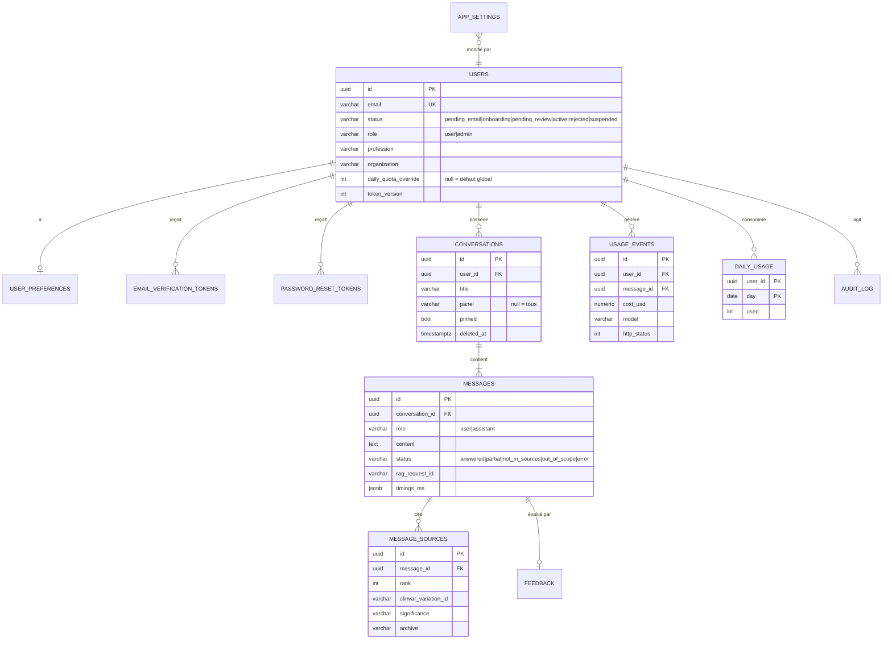
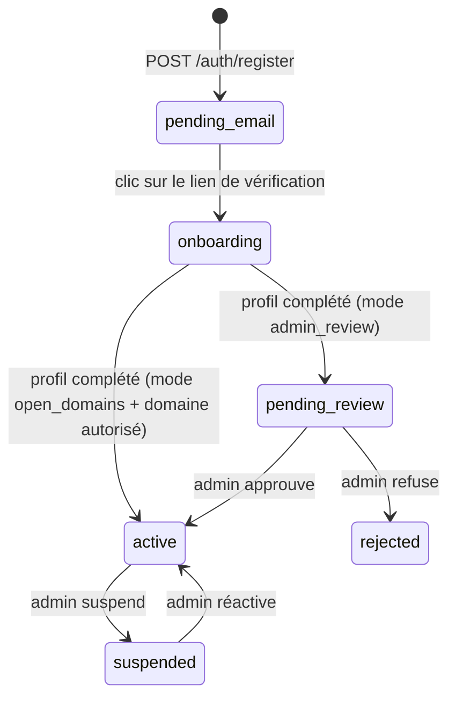

# Fiche de modélisation — backend de l'application Genomica

> Statut : **proposition à valider** avant implémentation. Date : 2026-10-22.
> Base : code de `RAG/src/api/` (contrat de l'API RAG), tables `gold/analytique` lues le 22/10/2026,
> starter imposé `Dakar2024/api-starter-Litestar` (lu sur GitHub : Litestar, **Piccolo ORM**, JWT en
> cookie, Huey + Redis, MinIO, SMTP), maquettes du canvas « Genomica — Proposition de design ».
> **[vérifié]** = lu dans le code ou les données ; **[proposé]** = choix à valider.

---

## 1. Rôle du backend en une phrase

Le backend est un **BFF** (*backend for frontend*) : le navigateur ne parle qu'à lui. Il gère les
comptes, garde la clé de l'API RAG, relaie les questions, enregistre l'historique, applique quotas
et budget, et sert les chiffres de `gold/analytique` en lecture seule.

```
Navigateur ──► backend apps (Litestar)
                 ├─ PostgreSQL « apps »  : comptes, conversations, quotas, réglages, audit
                 ├─ Redis + Huey          : e-mails, purges planifiées
                 ├─ rag-gateway           : POST /v1/questions (X-API-Key côté serveur)
                 └─ DuckDB en processus   : delta_scan sur MinIO gold/analytique (compte lecture seule)
```

Pourquoi ce découpage :

- **La clé RAG ne quitte jamais le serveur.** `require_api_key` compare `X-API-Key` en temps
  constant [vérifié, `security.py`] : une clé dans le navigateur serait publique.
- **Base séparée** de `rag-postgres` et de la base Airflow : moindre privilège, sauvegarde et
  purge RGPD indépendantes.
- **Le RAG reste sans état** (une question = un appel, pas de mémoire) [vérifié, `QuestionIn`
  n'a que `question` et `trace`]. L'historique est une affaire d'application, donc du backend.

---

## 2. Découpage en features (convention du starter)

Chaque feature suit `tables.py / schemas.py / service.py / controller.py / piccolo_app.py /
migrations/` comme `features/auth` [vérifié]. La logique vit dans `service.py`, testable sans HTTP.

| Feature | Rôle |
|---|---|
| `auth` (starter, étendu) | inscription = demande d'accès, vérification e-mail, connexion, statuts |
| `preferences` | thème, couleur d'accent, densité, panel par défaut |
| `assistant` | conversations, relais RAG, sources figées, retours utile / à améliorer |
| `usage` | quotas journaliers, budget mensuel, registre des coûts |
| `analytics` | lecture DuckDB de `gold/analytique`, cache par archive |
| `admin` | demandes d'accès, utilisateurs, réglages, tableau de bord, santé des services |
| `audit` | journal des actions sensibles (pas de feature HTTP propre : utilisé par les autres) |

---

## 3. Modèle de données

### 3.1 Diagramme entité-association



### 3.2 Tables détaillées [proposé]

**`users`** — étend la table du starter [vérifié : `id, email, hashed_password, full_name, role,
phone, location, profile_picture, is_active, created_at`].

| Colonne | Type | Pourquoi |
|---|---|---|
| `status` | Varchar, défaut `pending_email` | remplace le booléen `is_active` : six états (§ 4.1) |
| `profession` | Varchar null | biologiste, généticien, bioinformaticien… (renseigné à l'onboarding) |
| `organization`, `intended_use` | Varchar / Text | examen de la demande par l'admin |
| `email_verified_at`, `approved_at`, `last_login_at` | Timestamptz null | traçabilité |
| `approved_by` | FK `users` null | qui a validé |
| `rejection_reason` | Text null | affiché dans l'e-mail de refus |
| `terms_accepted_at`, `no_patient_data_pledge_at` | Timestamptz | preuve des deux cases cochées |
| `daily_quota_override` | Integer null | quota individuel ; null = réglage global |
| `token_version` | Integer, défaut 0 | incrémenté à la suspension ou au changement de mot de passe : invalide les JWT déjà émis |

> `is_active` peut rester comme colonne calculée de compatibilité (`status == "active"`), mais une
> seule source de vérité : `status`.

**`email_verification_tokens`** — calquée sur `password_reset_tokens` du starter, avec une
différence : **stocker l'empreinte SHA-256 du jeton, pas le jeton** (le starter stocke `token` en
clair [vérifié]). Une fuite de la base ne doit pas permettre d'activer des comptes. Même remarque
pour `password_reset_tokens`.

**`user_preferences`** (1-1 avec `users`) : `theme` (`system|light|dark`), `accent`
(`helix|indigo|ocean|graphite`), `density` (`comfortable|compact`), `reduced_motion` (bool),
`default_panel` (null = tous). Table séparée pour ne pas réécrire `users` à chaque clic.

**`conversations`** : `user` FK, `title` (premiers ~60 caractères de la première question),
`panel` (filtre choisi), `pinned`, `created_at`, `updated_at`, `deleted_at` (suppression douce, purge
réelle par tâche, § 4.6).

**`messages`** : `conversation` FK, `role` (`user|assistant`), `content` (question ou texte de
réponse), et pour l'assistant : `status`, `scope_reason`, `history` (JSONB, liste de phrases),
`disclaimer`, `rag_request_id`, `timings_ms` (JSONB), `archive` (ex. `2026-10`), `created_at`.

**`message_sources`** — **copie figée** des sources au moment de la réponse : `rank`, `doc_id`,
`gene`, `variant`, `protein`, `significance`, `significance_fr`, `review_status`,
`clinvar_variation_id`, `clinvar_url`, `archive`, `previous_significance(_fr)`, `previous_until`
[vérifié : ce sont exactement les champs de `Source`, `answer.py`].
Pourquoi copier plutôt que pointer vers `rag_documents` : ClinVar est rechargé chaque mois et un
variant peut être reclassé. Une conversation relue dans six mois doit montrer **ce qui a été
répondu**, avec l'archive d'alors. C'est la traçabilité promise par la problématique. Une table
plutôt qu'un JSONB, pour que l'admin puisse compter les gènes ou variants les plus cités.

**`feedback`** : `message` FK unique par utilisateur, `rating` (+1 / −1), `comment`, `status`
(`new|reviewed`), `reviewed_by`, `created_at`.

**`usage_events`** — registre append-only, une ligne par appel au RAG, **sans le texte** :
`user`, `message` (null si erreur), `status`, `http_status`, `error_code`, `cost_usd`
(Numeric(10,6)), `model`, `provider_name`, `latency_ms`, `created_at`. Sert au budget, au tableau de
bord admin et à l'audit des coûts.

**`daily_usage`** : clé `(user, day)`, `used`. Compteur dédié au quota, mis à jour de façon
atomique (§ 4.3). On ne recompte pas `usage_events` à chaque question.

**`app_settings`** — une seule ligne (ou clé/valeur typée) : `registration_mode`
(`admin_review|open_domains|invite_only`), `allowed_email_domains` (Array), `default_daily_quota`
(20), `monthly_budget_usd` (50), `conversation_retention_days` (90 ; 0 = ne pas conserver),
`admin_trace_visible` (bool), `banner_message`, `updated_by`, `updated_at`.

**`audit_log`** : `actor` FK, `action` (`user.approve`, `user.reject`, `user.suspend`,
`user.role_change`, `settings.update`…), `target_type`, `target_id`, `details` (JSONB, sans
donnée sensible), `created_at`. Append-only.

### 3.3 Ce qui n'est **pas** dans la base de l'application

- Les **panels, gènes et chiffres analytiques** : lus dans `gold/analytique`, jamais recopiés. Le
  Gold est la source de vérité, mise à jour chaque mois par Airflow.
- Le **texte des documents ClinVar** : il reste dans `rag-postgres`.

---

## 4. Logique métier

### 4.1 Cycle de vie d'un compte (machine à états)



Règles :

- **Une seule fonction de transition** dans `auth/service.py`, du type
  `transition(user, to_status, actor) -> User`, qui refuse toute transition absente du diagramme
  et écrit l'`audit_log`. Les contrôleurs ne modifient jamais `status` directement. C'est la
  logique à tester en premier (table de transitions exhaustive).
- **Inscription minimale** : l'écran ne demande que l'e-mail professionnel, le mot de passe (et sa
  confirmation, côté navigateur seulement) et une case qui vaut acceptation des conditions et engagement
  « aucune donnée patient » (les deux dates sont stockées). Les domaines de messageries grand public
  (Gmail, Outlook.com, Orange…) sont refusés côté serveur, en plus de `allowed_email_domains`.
  Nom, fonction et établissement sont demandés à l'étape `onboarding`, après la vérification de
  l'e-mail : l'administrateur n'examine que des profils complets.
- **SSO Microsoft (Entra ID)** : un compte créé par SSO arrive directement à `onboarding` (e-mail
  déjà vérifié par Microsoft) ; même règle de domaine professionnel.
- **Connexion** : refusée hors `active`, avec un message par état (« vérifiez votre e-mail »,
  « demande en cours d'examen », « compte suspendu »).
- **Réponses neutres** sur `/register` et `/forgot-password` : même réponse que l'e-mail existe ou
  non, pour ne pas révéler qui a un compte.
- **Révocation immédiate** : le JWT contient `sub` et `tv` (`token_version`). La garde relit
  l'utilisateur (ou un cache Redis de quelques secondes) et refuse si `status != active` ou si
  `tv` ne correspond plus. Sans cela, un compte suspendu garde l'accès jusqu'à l'expiration du
  jeton (24 h dans le starter [vérifié, `ACCESS_TOKEN_EXPIRE_MINUTES = 60 * 24`]).
- **Garde admin à créer** : le starter n'a que `auth_guard` [vérifié, `core/guards.py`]. Ajouter
  `active_user_guard` et `admin_guard` (rôle `admin` lu en base, pas seulement dans le jeton).
- **E-mails** (Huey) : vérification, « demande reçue » à l'admin, approbation, refus.

### 4.2 Poser une question — le flux complet

`POST /api/assistant/questions` avec `{conversation_id?, question, panel?}` :

1. **Validation** (schéma) : 1 à 1 000 caractères, comme l'API RAG [vérifié, `QuestionIn`]. Refuser
   tôt évite un appel inutile.
2. **Réservation du quota** (§ 4.3) ; refus `429 quota_exceeded` avec l'heure de remise à zéro.
3. **Contrôle du budget mensuel** : somme `usage_events.cost_usd` du mois (en cache) ≥ budget →
   `503 budget_exhausted`.
4. **Écriture** de la conversation (création si besoin) et du message `user`, dans une transaction
   courte, **avant** l'appel : la question n'est pas perdue si le RAG échoue.
5. **Appel RAG** via `httpx.AsyncClient` partagé (créé au démarrage, fermé à l'arrêt),
   `X-API-Key` depuis l'environnement, **`trace: true` toujours**. Raison : le coût, le modèle et le
   fournisseur ne sont renvoyés que dans la trace [vérifié, `PipelineResult.as_dict`]. Délai
   client légèrement supérieur à `request_timeout_s` du RAG, pour recevoir son `503 timeout`
   plutôt que couper avant.
6. **Traduction des erreurs** RAG [vérifié, `_MESSAGES` de `app.py`] :

   | RAG | Backend → navigateur | Quota |
   |---|---|---|
   | 200 | 200 + réponse | consommé |
   | 422 `invalid_question` | 422 | rendu |
   | 429 `busy` | 503 `assistant_busy` + `Retry-After: 2` | rendu |
   | 503 `timeout` / `unavailable` (+ `Retry-After`) | 503 en recopiant `Retry-After` | rendu |
   | 503 `index_empty` | 503 `index_building` (message « base en cours de construction ») | rendu |
   | 401 | 500 `internal` + alerte : c'est une erreur de configuration, pas de l'utilisateur | rendu |
   | réseau, délai client | 503 `assistant_unavailable` | rendu |

   « Rendu » = la réservation est annulée : l'utilisateur ne paie pas une panne.
7. **Enregistrement** dans une transaction : message `assistant`, `message_sources` (dans l'ordre
   des citations), `usage_events`, mise à jour de `conversations.updated_at`.
8. **Réponse au navigateur** : DTO **sans la trace**, sauf rôle admin **et**
   `admin_trace_visible`. Le coût n'est jamais montré à un utilisateur ordinaire.

Les quatre statuts sont des **réponses**, pas des erreurs [vérifié :
`STATUSES = ("answered", "partial", "not_in_sources", "out_of_scope")`]. Ils consomment le quota,
s'affichent chacun avec son encadré (maquette « Assistant », réglage *answerStatus*) et
`scope_reason` (`counting`, `acmg`, `frequency`, `clinical_advice`, `other`) sert à proposer la
bonne redirection (par exemple, `counting` → l'explorateur).

**Pas de mémoire de conversation** : la conversation est un fil d'affichage, chaque question part
seule au RAG. Ne pas concaténer l'historique dans `question` : cela contournerait les contrôles du
RAG, qui raisonnent sur une question à la fois.

**Le filtre de panel se fait dans le RAG, au moment de la recherche** [proposé, recommandé].
`QuestionIn` refuse aujourd'hui tout champ inconnu [vérifié, `forbid_unknown_fields=True`], mais
le retriever filtre déjà en SQL sur `panel = ANY(%(panels)s)` avec la constante globale `PANELS`
[vérifié, `retriever.py`]. L'évolution consiste à faire de cette constante un paramètre :

- `QuestionIn.panels: list[Literal["brca", "sickle"]] | None = None` ; `None` = tous les panels,
  donc comportement inchangé pour les clients actuels et pour la mesure E3a ;
- le filtre reste **dans la requête, avant le `LIMIT`**. Filtrer après coup, dans le backend,
  enlèverait des documents du top-k et renverrait moins de sources ;
- le message `gene_out_of_panel` est adapté : « hors du panel sélectionné » plutôt que « hors des
  18 gènes » ;
- les panels retenus sont écrits dans la trace et dans `message`, pour la traçabilité.

À exclure : un sélecteur purement décoratif. Afficher « Drépanocytose » alors que la réponse peut
venir de BRCA1 promet une restriction qui n'existe pas, ce qui est inacceptable dans un outil
clinique. Tant que l'évolution du RAG n'est pas faite, le sélecteur est masqué dans l'assistant et
le filtre n'existe que dans l'explorateur.

### 4.3 Quota sans course critique

Deux onglets qui envoient en même temps ne doivent pas dépasser le quota. Une requête atomique
réserve une unité seulement s'il en reste :

```sql
INSERT INTO daily_usage (user_id, day, used) VALUES ($1, $2, 1)
ON CONFLICT (user_id, day) DO UPDATE SET used = daily_usage.used + 1
WHERE daily_usage.used < $3
RETURNING used;
```

Aucune ligne renvoyée = quota atteint. En cas d'échec du RAG, `used = used - 1`. Le jour est
calculé en **UTC** (ou fuseau de l'application, à fixer une fois) et la remise à zéro est affichée
dans ce fuseau. Requête paramétrée, jamais de f-string.

### 4.4 Analytique (`gold/analytique`)

- **Lecture** : DuckDB (`delta_scan`) sur MinIO, avec un **compte de service MinIO en lecture
  seule limité à `gold/analytique/*`**, distinct de `MINIO_AIRFLOW_USER`.
- **DuckDB est synchrone** : chaque requête passe par `anyio.to_thread.run_sync`, avec une
  connexion par thread (une connexion DuckDB n'est pas partagée entre threads sans précaution).
- **Cache** clé `(endpoint, panel, archive)`. Le Gold ne change qu'au run mensuel : invalider quand
  la version de la table Delta change (lecture peu coûteuse du journal Delta), sinon TTL d'une heure.
- **Endpoints**, tous filtrables par `panel` :

  | Route | Source [vérifié] | Écran |
  |---|---|---|
  | `GET /api/panels` (public) | `agg_variants_by_gene_significance` + `dim_gene` | accueil, connexion |
  | `GET /api/analytics/overview` | agrégats ci-dessus | indicateurs |
  | `GET /api/analytics/genes` | `agg_variants_by_gene_significance` | barres empilées |
  | `GET /api/analytics/genes/{symbol}` | idem + `dim_gene` + `bridge_gene_phenotype` | fiche gène |
  | `GET /api/analytics/review-status` | `agg_review_status` (+ correspondance en étoiles) | niveaux de revue |
  | `GET /api/analytics/variant-types` | `fact_variant.variant_type` | types de variation |
  | `GET /api/analytics/diseases` | `fact_variant_disease` × `dim_disease` | maladies |
  | `GET /api/analytics/reclassifications` | `agg_reclassifications_by_month`, `fact_reclassification` | courbe |

- **Regroupement des significations** : ClinVar a des libellés composites (`Pathogenic/Likely
  pathogenic`, `Pathogenic; other`…). Une seule fonction pure `classify_significance(label) ->
  SignificanceClass` (P, LP, VUS, LB, B, conflictuel, autre), **testée sur tous les libellés
  présents dans le Gold**, utilisée par l'API et par l'export CSV. Les totaux de la maquette en
  sortent : 97 192 variants, dont 19 161 pathogènes, 3 002 probablement pathogènes, 30 650 VUS.
- **Étoiles de revue** : réutiliser `_REVIEW_STATUS_STARS` de `silver_to_gold_analytique.py`
  [vérifié] plutôt que d'en recopier une seconde version, ou mieux, lire `dim_review_status.stars`.
- **Constat au 22/10/2026** : `fact_reclassification` et `agg_reclassifications_by_month` sont
  **vides** [vérifié] : une seule archive (2026-10) est chargée. L'API renvoie une liste vide avec
  `{"available_from_next_archive": true}` et l'écran affiche l'état vide prévu dans la maquette.

### 4.5 Administration

- **Demandes d'accès** : liste `pending_review` ; approuver ou refuser passe par la fonction de
  transition (§ 4.1), avec e-mail et ligne d'audit.
- **Utilisateurs** : rôle, suspension, quota individuel. Interdire qu'un admin se retire son propre
  rôle ou suspende le dernier admin actif.
- **Tableau de bord** : agrégats SQL sur `usage_events` et `feedback` (questions du jour, actifs
  sur 7 jours, coût du mois, latence médiane et p95, répartition des statuts, retours négatifs).
- **Santé** : `GET /ready` du RAG (avec la clé), un `SELECT 1` DuckDB, et en option la date du
  dernier run Airflow via son API REST. Les quatre états affichés : opérationnel, dégradé, en
  panne, planifié, chacun avec icône et libellé (jamais la couleur seule).
- **Réglages** : `PATCH /api/admin/settings`, validation stricte (domaines, bornes du quota,
  budget ≥ 0), audit avant/après.

### 4.6 Rétention et RGPD

- Tâche Huey périodique (`@huey.periodic_task`, quotidienne) : supprime définitivement les
  conversations `deleted_at` ou plus anciennes que `conversation_retention_days`, avec leurs
  messages, sources et retours (`ON DELETE CASCADE`). `usage_events` garde `user` et coûts mais
  plus de lien vers un message supprimé (`message` mis à null).
- Rappel permanent dans le composer : « Ne saisissez aucune donnée permettant d'identifier un
  patient ». Les journaux du backend, comme ceux du RAG [vérifié, `_ALLOWED` dans `logs.py`],
  ne contiennent **jamais** la question ni la réponse.
- Droit à l'effacement : `DELETE /api/me` (suppression du compte et de tout son historique).

### 4.7 Préférences et thème

`GET /api/auth/me` renvoie les préférences. Le serveur pose aussi un petit cookie non sensible
`theme` pour que le rendu côté serveur applique le bon thème **dès le premier affichage** (sinon,
écran blanc puis bascule en sombre). `system` est résolu par le navigateur
(`prefers-color-scheme`).

### 4.8 Sécurité transverse

- **CSRF** : l'authentification passe par cookie [vérifié, `COOKIE_NAME = "access_token"`] ; il
  faut `SameSite=Lax` (ou `Strict`) et le `CSRFConfig` de Litestar sur les méthodes non sûres.
- **Limitation de débit** sur `/login`, `/register`, `/forgot-password` (par IP et par e-mail,
  compteur Redis).
- **CORS** limité à `FRONTEND_URL`.
- **Secrets** uniquement par `.env` : `RAG_API_KEY`, `RAG_BASE_URL`, `ANALYTICS_S3_*`,
  `SECRET_KEY`. Vérifier que `.env` est bien dans `.gitignore` du dossier `apps/`.

---

## 5. Routes

| Méthode et chemin | Garde | Rôle |
|---|---|---|
| `POST /api/auth/register` | public, limité | crée un compte `pending_email` (e-mail professionnel, mot de passe, consentement) |
| `PUT /api/me/onboarding` | e-mail vérifié | nom, fonction, établissement, usage prévu ; passe à l'examen |
| `GET /api/auth/microsoft/start` · `/callback` | public | SSO Entra ID ; `next` validé comme une redirection sûre |
| `POST /api/auth/verify-email` | public | consomme le jeton, passe à l'état suivant |
| `POST /api/auth/login` · `DELETE /api/auth/logout` | public / auth | session |
| `POST /api/auth/forgot-password` · `/reset-password` | public, limité | starter |
| `GET /api/auth/me` · `PATCH /api/auth/me` · `DELETE /api/me` | actif | profil, effacement |
| `GET /api/me/preferences` · `PUT /api/me/preferences` | actif | apparence |
| `GET /api/me/usage` | actif | quota restant, remise à zéro |
| `GET /api/panels` | public | panels, gènes, archive |
| `POST /api/assistant/questions` | actif | § 4.2 |
| `GET /api/assistant/conversations?cursor=&q=` | actif | liste paginée par curseur, recherche dans les titres |
| `GET /api/assistant/conversations/{id}` | propriétaire | fil complet avec sources |
| `PATCH /api/assistant/conversations/{id}` | propriétaire | titre, épingle |
| `DELETE /api/assistant/conversations/{id}` | propriétaire | suppression douce |
| `PUT /api/assistant/messages/{id}/feedback` | propriétaire | +1 / −1, commentaire |
| `GET /api/analytics/*` | actif | § 4.4 |
| `GET /api/admin/requests` · `POST …/{id}/approve` · `…/reject` | admin | § 4.5 |
| `GET /api/admin/users` · `PATCH /api/admin/users/{id}` | admin | rôle, statut, quota |
| `GET /api/admin/metrics` · `GET /api/admin/health` · `GET /api/admin/feedback` | admin | tableau de bord |
| `GET /api/admin/settings` · `PATCH /api/admin/settings` | admin | réglages |

**Propriétaire** = la requête filtre toujours sur `user_id` de la session ; une conversation d'un
autre utilisateur répond **404**, pas 403, pour ne pas révéler son existence.

---

## 6. Schémas d'échange (extraits)

```python
class AskQuestionIn(BaseModel):
    model_config = ConfigDict(extra="forbid")
    conversation_id: UUID | None = None
    question: Annotated[str, StringConstraints(strip_whitespace=True, min_length=1, max_length=1000)]
    panel: Literal["brca", "sickle"] | None = None


class SourceOut(BaseModel):
    rank: int
    gene: str | None
    variant: str | None
    protein: str | None
    significance: str | None
    significance_fr: str | None
    review_status: str | None
    stars: int | None
    clinvar_variation_id: str | None
    clinvar_url: str | None
    archive: str | None
    previous_significance_fr: str | None
    previous_until: str | None


class AnswerOut(BaseModel):
    message_id: UUID
    conversation_id: UUID
    status: Literal["answered", "partial", "not_in_sources", "out_of_scope"]
    scope_reason: str | None
    answer: str
    history: list[str]
    sources: list[SourceOut]
    disclaimer: str
    timings_ms: dict[str, float]
    quota_remaining: int
    trace: dict | None = None  # admin + réglage uniquement
```

Les panels acceptés (`brca`, `sickle`) doivent venir d'une seule constante partagée avec
`src/ingestion/config.py` (`PANEL_GENES`) plutôt que d'être recopiés.

---

## 7. Tests à écrire en premier

Logique critique, testée sans HTTP ni conteneur, conformément à `CLAUDE.md` :

1. **Transitions de statut** : chaque couple (état, cible) autorisé ou refusé ; l'audit est écrit.
2. **Réservation de quota** : 20 réservations concurrentes sur un quota de 5 → exactement 5
   succès ; l'annulation rend bien l'unité.
3. **Traduction des erreurs RAG** : chaque ligne du tableau § 4.2 (statut, code, `Retry-After`,
   quota rendu ou non), avec `httpx.MockTransport`.
4. **Retrait de la trace** : un utilisateur ne reçoit jamais `trace` ni `cost_usd`.
5. **`classify_significance`** sur tous les libellés distincts du Gold ; la somme par classe
   retombe sur 97 192.
6. **Copie figée des sources** : l'ordre et tous les champs de `Source` sont conservés.
7. **Isolation** : la conversation d'un autre utilisateur répond 404.

---

## 8. Points à vérifier ou à trancher

- **Migrations** : le starter utilise les migrations Piccolo [vérifié, `features/auth/migrations/`] ;
  elles jouent le rôle d'Alembic. Aucune modification de schéma à la main.
- **`python-jose`** dans les dépendances du starter [vérifié] : sa maintenance a été irrégulière et
  des failles ont été publiées en 2024 (à confirmer sur PyPI et la base GitHub Advisory avant de
  trancher). Je recommande d'évaluer **PyJWT** à la place.
- **Dépendances non épinglées** dans `requirements.txt` du starter [vérifié] : épingler (ou
  passer à `uv` avec `uv.lock`) avant la mise en production.
- **Réseau Docker** : relier le conteneur `api` au réseau de `rag-gateway` plutôt que de passer par
  `127.0.0.1:8090` de l'hôte.
- **E-mails** : le starter est réglé sur Brevo, le pipeline utilise déjà Resend (SMTP 465 en SSL).
  Un seul fournisseur, c'est plus simple : Resend fonctionne en SMTP avec `aiosmtplib`, à tester.
- **Filtre de panel** (§ 4.2) : évolution recommandée du RAG (paramètre `panels` facultatif), à
  planifier après la mesure E3a ; d'ici là, sélecteur masqué dans l'assistant.
- **Durée de conservation** par défaut (90 jours proposés) et mentions RGPD.
