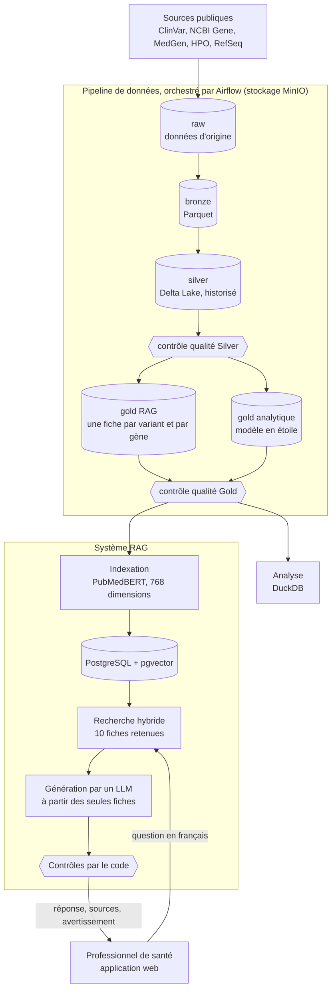

# Architecture générale du projet

*Note à l'attention du Dr Nourou SYLLA, directeur de mémoire. État du projet au 1er novembre 2026.*

---

## 1. Vue d'ensemble

Le projet transforme des données génomiques publiques en une base de connaissances fiable, puis
permet de l'interroger en français. L'architecture comporte deux grands blocs :

- **le pipeline de données**, qui collecte, nettoie, contrôle et historise les données chaque mois ;
- **le système RAG**, qui retrouve les fiches utiles, fait rédiger une réponse à partir de ces
  fiches, puis la vérifie avant de l'afficher.

Le périmètre est un panel de **18 gènes** : 12 liés au cancer du sein héréditaire et 6 liés à la
drépanocytose. L'ensemble tourne sur une seule machine, avec des conteneurs Docker, sans processeur
graphique obligatoire.

## 2. Le pipeline de données

### 2.1 Les sources

| Source | Apport | Accès |
|---|---|---|
| ClinVar | Variants et signification clinique | Archive mensuelle (environ 440 Mo) |
| NCBI Gene | Description et localisation des gènes | API E-utilities |
| MedGen | Maladies, numéros OMIM, modes de transmission | API E-utilities |
| HPO | Phénotypes associés aux gènes | Fichier et API |
| RefSeq | Transcrits de référence, pour normaliser la notation HGVS | API E-utilities |

### 2.2 Les quatre couches

Le pipeline suit une architecture médaillon : chaque couche a un seul rôle et ne lit que la
précédente.

| Couche | Rôle | Format |
|---|---|---|
| `raw` | Copie fidèle de la source, jamais modifiée | Format d'origine |
| `bronze` | Même contenu, format et noms de colonnes uniformisés | Parquet |
| `silver` | Données nettoyées, dédoublonnées et reliées ; historique des reclassifications ClinVar (SCD2) | Delta Lake |
| `gold` | Tables finales : fiches textuelles pour le RAG, modèle en étoile pour l'analyse | Delta Lake |

Comme `raw` conserve la donnée d'origine, tout retraitement peut repartir de cette couche sans
rappeler les API.

### 2.3 L'orchestration

Apache Airflow enchaîne les traitements, sans porter la logique métier : celle-ci reste dans du code
Python testé indépendamment. Le calcul repose sur Polars et le stockage sur MinIO, compatible S3.

1. **`dag_acquisition_sources`**, le 10 de chaque mois à 06:00 UTC, télécharge les sources communes
   aux deux panels (ClinVar et fichiers HPO).
2. **Un DAG par panel** (`brca` et `sickle`) démarre ensuite automatiquement. Il collecte les données
   propres au panel, puis exécute les traitements de `raw` à `gold`, les contrôles et l'indexation.
3. **Un e-mail** signale chaque échec définitif de tâche et chaque run de panel réussi.

Le pipeline ne traite que le mois en cours. Ajouter un panel doit se limiter à modifier la
configuration ; cette propriété reste à démontrer (objectif OS3).

### 2.4 Les garanties de fiabilité

- **Écriture complète ou invisible :** une partition n'est lisible par l'étape suivante qu'après
  l'écriture de son marqueur `_SUCCESS`.
- **Contrôles bloquants :** une table vide, des liens incohérents ou une archive tronquée arrêtent
  le run, et la couche suivante n'est pas écrite. Les contrôles Silver sont faits avant et après la
  publication.
- **Traçabilité :** chaque fiche Gold porte la version de sa source et son lien vers ClinVar.
- **Mise à jour incrémentale :** l'identifiant d'un fragment est l'empreinte SHA-256 de son texte.
  Seules les fiches modifiées sont donc recalculées : 1 695 sur 97 211 (1,7 %) au passage de
  septembre à octobre 2026.

## 3. Le système RAG

### 3.1 Indexation

Après le contrôle Gold, chaque fiche est convertie en vecteur par **PubMedBERT**, puis stockée dans
PostgreSQL avec pgvector. Avant toute indexation, le code vérifie que le service sert bien le modèle
attendu. Des vecteurs issus de deux modèles ne peuvent donc pas cohabiter dans l'index.

Une réindexation complète prend environ 9 minutes sur GPU et 4 heures sur CPU. Le fonctionnement
courant reste possible sur CPU, puisque seules les fiches modifiées sont recalculées.

### 3.2 Recherche

La question, en français, passe d'abord par deux analyses : des règles extraient les identifiants et
les gènes, puis un LLM produit une reformulation en anglais et repère la signification clinique
demandée. La recherche s'effectue ensuite en trois étages :

1. **Correspondance exacte** sur les identifiants de variant (rs, HGVS) ;
2. **Filtres** sur le gène et la signification clinique ;
3. **Similarité cosinus** entre la reformulation et les fiches.

Ce choix répond à une limite mesurée : la similarité seule obtient un score de 0 sur les questions
citant un identifiant, contre 1,000 pour la recherche complète (essai du 5 octobre 2026). La
recherche vectorielle reste exacte, car l'index approché HNSW n'a atteint qu'un rappel de 0,515 par
rapport à elle.

### 3.3 Génération et contrôles

Le LLM reçoit les 10 fiches retenues et doit répondre à partir d'elles seules, dans un format JSON
strict. Le code vérifie ensuite que :

- chaque source citée fait partie des fiches transmises ;
- chaque identifiant écrit existe dans ces fiches ;
- chaque signification clinique est bien celle du variant concerné.

**Une réponse qui échoue à un contrôle n'est pas affichée.** Les questions hors périmètre (conseil
clinique, comptage, fréquence) reçoivent un message fixe. Ces contrôles reposent sur des motifs de
texte : ils réduisent le risque d'erreur sans l'éliminer, et les maladies et phénotypes cités ne sont
pas vérifiés.

## 4. L'application et l'exploitation

- **Application :** une interface web et un backend Litestar gèrent les comptes et l'assistant. Le
  backend interroge l'API du RAG, elle aussi écrite avec Litestar, par une passerelle nginx.
- **Sécurité :** les interfaces ne sont accessibles que depuis la machine. La seule sortie Internet
  de l'API du RAG passe par un proxy qui n'autorise que les fournisseurs de LLM.
- **Supervision (optionnelle) :** Prometheus et Grafana suivent les volumes, la fraîcheur des données
  et les ressources, avec quatre alertes par e-mail.
- **Sauvegarde :** un script copie le lac de données, la base d'Airflow et la base vectorielle ; des
  scripts dédiés vérifient que ces copies se restaurent.

## 5. Les principaux choix d'architecture

| Choix | Raison |
|---|---|
| Architecture médaillon | Séparer les rôles, contrôler chaque étape et pouvoir tout rejouer depuis `raw` |
| Airflow plutôt que NiFi | NiFi a été évalué puis écarté, notamment pour sa consommation mémoire : 1,37 Gio au repos |
| Delta Lake en Silver et Gold | Mises à jour fiables par `MERGE`, utiles notamment pour historiser les reclassifications |
| PubMedBERT plutôt que BioBERT | Écart moyen mesuré de +0,361 en sa faveur, IC 95 % [+0,257 ; +0,469] |
| Base vectorielle distincte du lac | Le Gold reste la source de vérité : l'index peut être entièrement reconstruit à partir de lui |
| Contrôles par le code après le LLM | Une réponse plausible mais fausse ne doit pas atteindre l'utilisateur |

## 6. État d'avancement

| Élément | État |
|---|---|
| Pipeline `raw` → `gold`, 18 gènes | Réalisé ; 97 211 fiches indexées |
| Indexation, recherche et génération | Réalisées et exposées par une API |
| Recette de la génération | Réalisée ; seuils non atteints : 19/20 sur les questions à identifiant et 9/10 sur les pièges, pour 100 % attendus |
| Application web | Branchée sur le RAG ; analytique backend à poursuivre |
| Supervision | En place ; métriques des tâches à vérifier au run du 10 novembre 2026 |
| Évaluation de la fidélité (E3a) | Outil prêt, campagne non lancée ; le modèle de génération reste provisoire |
| Comparaison avec un LLM seul (H3) | À réaliser |
| Empreinte du système et ajout d'un panel (OS3, OS4) | Mesures et démonstration à compléter |
